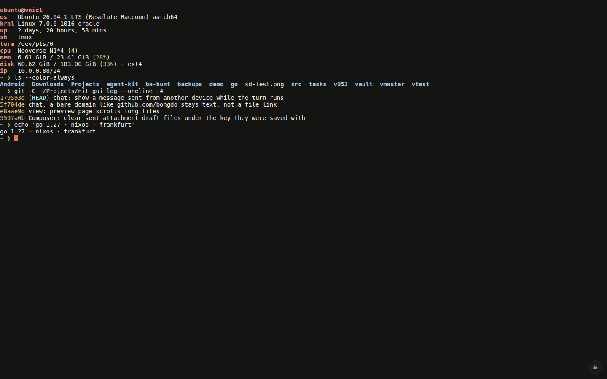

# web-terminal

A web terminal: one Go binary with an embedded React SPA, one tmux-backed shell
per workspace, and a URL contract instead of a bridge service.



Один бинарник, tmux-сессия на воркспейс, вкладки и полный PTY в браузере.

## Run

```sh
bin/run                 # local dev: 127.0.0.1:7795, gate off
bin/check               # gofmt, vet, tests, typecheck, frontend tests, build
```

Open <http://127.0.0.1:7795/term/>. Health is `GET /term/api/health`.

`bin/run` is development only: when no shared hash is present it exports
`TERM_GUI_INSECURE=1`, and the app refuses that mode on a non-loopback address.
Any other launch must have `NIT_GATE_PASSWORD_HASH` and
`NIT_GATE_LOGIN_URL`. There is no silent open mode.

## Access

```sh
bin/auth                # rotates the shared ~/.config/nit-gui/auth.env
bin/deploy              # build, restart on 127.0.0.1:7795, health check
bin/funnel              # public  https://<host>:8443/term/ behind the password
bin/serve               # private https://<host>:8443/term/ (tailnet only)
```

`bin/funnel` and `bin/serve` both use their own HTTPS port. Do not mount the
terminal as a path on the funneled `:443`: Tailscale strips the `--set-path`
prefix before proxying, so the app would receive `/` instead of `/term/` and
answer 404. A root mount on a dedicated port preserves the path, which is what
`base: "./"` and `apiBase()` in the SPA expect.

`bin/deploy` refuses to start without the shared auth file. `bin/funnel` and
`bin/serve` refuse to publish unless the running app answers `/term/api/health`
with `401`, so an insecure dev process cannot be exposed by accident.
nit-gui is the only login page: every request without a valid `nit_gate` cookie
is redirected to `https://<host>/nit/auth?next=<absolute URL>`; `/term/auth` and
`/term/auth/logout` do not exist (404), and `/api/*` gets `401`. The cookie is
`HttpOnly`, `SameSite=Lax`, 7 days, `Path=/`, and `Secure` when the request
arrives over HTTPS. It is an HMAC-signed expiry, so it survives restarts and is
accepted by nit-gui and pero-gui on the same hostname. Set
`TERM_GUI_PERO_URL` when the editor lives on a different origin; `bin/deploy`
defaults it to `https://<host>/pero/`.

## URL contract

| URL | Effect |
| --- | --- |
| `/term/?dir=/abs/path` | attach to the session for that directory, creating it if needed |
| `/term/?session=<name>` | attach to an explicit session |
| `/term/` | session for `$HOME` |

The SPA strips the query with `history.replaceState` after reading it.

The SPA also listens on the same-origin `BroadcastChannel` `nit-term`. A message
`{type:"open", id, dir}` or `{session}` switches the attached session without a
reload and is answered with `{type:"ack", id}`; nit-gui uses it for workspace
links and falls back to a new tab when nothing answers. Switching kills the
current tmux session when this browser is its only client, exactly like a reload.

## UI and keys

The terminal fills the whole page. A floating button in the bottom-right corner
opens session state, cwd, font size, theme and reconnect. There are no permanent
top or bottom bars.

| Key | Effect |
| --- | --- |
| Ctrl/Cmd+V | paste into the terminal |
| Ctrl+Shift+V | browser-native paste fallback |
| Ctrl/Cmd+, | toggle settings |
| middle click | paste |
| select | copy, with a one-line toast |

Ctrl+V is intercepted before xterm.js sees it, so it pastes instead of sending
`^V` to the shell. Shell quoted-insert is not available.

Sessions are named `tg-<12 hex of sha256(dir)>`. Explicit names must match
`^[A-Za-z0-9_-]{1,40}$`. `dir` must be an absolute path inside
`TERM_GUI_ALLOWED_ROOTS`, and must exist; anything else is a 400 before a PTY is
spawned.

## Linking into the terminal

The same direction as nit/pero's `?open=` link, in reverse:

```ts
export function termHref(base: string, dir: string): string {
  const url = base.endsWith("/") ? base : `${base}/`;
  return `${url}?dir=${encodeURIComponent(dir)}`;
}

termHref("/term/", "/home/ubuntu/Projects/pero-gui");
// "/term/?dir=%2Fhome%2Fubuntu%2FProjects%2Fpero-gui"
```

From the terminal, Ctrl/Cmd+click on an absolute path or `file:line` opens
`${TERM_GUI_PERO_URL}?open=<path>&line=<n>` (`/pero/` by default) in a new tab.
Relative paths resolve against the last OSC 7 cwd, then the session directory.

## Environment

| Variable | Default | Meaning |
| --- | --- | --- |
| `TERM_GUI_BASE_PATH` | `/term` | URL prefix. Set to empty to serve at `/`. |
| `TERM_GUI_ALLOWED_HOSTS` | — | comma-separated extra Host values; loopback always allowed |
| `TERM_GUI_ALLOWED_ORIGINS` | loopback origins on a loopback bind | required explicit `scheme://host:port` allowlist for Origin |
| `TERM_GUI_TRUST_PROXY` | `0` | trust `X-Forwarded-Host`/`X-Forwarded-Proto`; set by `bin/deploy` for Funnel |
| `TERM_GUI_ALLOW_NO_ORIGIN` | `0` | allow WebSocket clients without `Origin` (CLI only) |
| `TERM_GUI_INSECURE` | `0` | local dev only: disable the gate, loopback bind required |
| `TERM_GUI_ALLOWED_ROOTS` | `$HOME` | allowed `dir` and home roots, path-list separated |
| `TERM_GUI_AUTH_ENV` | `~/.config/nit-gui/auth.env` | shared auth file |
| `NIT_GATE_PASSWORD_HASH` | — | shared PBKDF2-SHA256 hash; required unless `TERM_GUI_INSECURE=1` |
| `NIT_GATE_LOGIN_URL` | — | central login page; required when the gate is enabled |
| `TERM_GUI_MAX_SESSIONS` | `8` | cap on concurrently attached PTYs |
| `TERM_GUI_PERO_URL` | `/pero/` | base of the editor link target |
| `TERM_GUI_DROP_URL` | — | absolute drop manager URL for the settings icon; `bin/deploy` sets `https://<host>/nit/drop/` |

Sessions run under a private tmux server with a generated config
(`tmux -L term-gui -f <generated>`), so they never touch the user's own tmux.
The config sets `status off`, `allow-passthrough on`, `history-limit 10000`,
`escape-time 0`, `mouse on` and `set-clipboard on`. Without a working tmux the
app falls back to a plain `$SHELL`. Either way the session dies when the last
browser disconnects, so a reload starts a fresh shell; open a second tab first
if you need to survive it.

Scrollback is owned by tmux. The mouse wheel enters tmux copy-mode; dragging
selects and copies through OSC 52. Hold Shift while dragging for xterm's native
selection, which also copies on select. `history-limit` is 10000 lines. On a
touch screen the mobile key bar has page-up/page-down buttons for the same
copy-mode history; Escape leaves copy-mode.

## API

- `GET /term/api/health` — `{ok, version, tmux, base}`
- `GET /term/api/check?dir=...` or `?session=...` — 200, 400, 401, 409 or 429 with a JSON error
- `GET /term/api/sessions` — `{sessions: [{name, dir, tmux, attached}]}`
- `GET /term/api/ws?dir=...` or `?session=...` — binary WebSocket

WebSocket protocol: the first client text frame is
`{"type":"resize","rows":24,"cols":80,"pixelWidth":900,"pixelHeight":600}`;
later keystrokes and clipboard paste are binary frames, chunked at 64 KiB;
`{"type":"flow","paused":true|false}` pauses and resumes PTY reads when the
terminal falls behind. PTY output is binary frames; `{"type":"hello",...}` is
the only other text frame. Origin is checked against Host on the handshake, not
only at the HTTP layer.

## Kitty graphics

`ESC _ G ... ESC \` with PNG (`f=100`) or raw RGB/RGBA (`f=24`, `f=32`),
including chunked transmission (`m=1`/`m=0`), transmit-then-place (`a=t`,
`a=p`) and delete (`a=d`). Images are drawn as `` overlays at the cursor
cell, anchored to their buffer line and moved on scroll. Unknown keys and
unsupported actions are consumed, never printed as text. No animation, no
Unicode placeholders, no z-index negotiation; at most 32 images and 32 MB of
pending data per connection.

xterm.js 6 has no APC hook on `terminal.parser`, so sequences are parsed in the
WebSocket-to-xterm write path (`web/src/lib/kitty.ts`) before xterm sees them.
DCS `tmux;` passthrough is unwrapped too.

Through tmux, use an emitter that wraps the sequence, for example
`chafa --format kitty --passthrough tmux`. Without tmux, raw emitters such as
`chafa` and `kitty icat` work directly.

## Security

The password is the only gate in front of a shell. The process runs as the
service user; `TERM_GUI_ALLOWED_ROOTS` (default `$HOME`) validates `?dir=` and
the default/home session, and once a shell is open it can go anywhere that user
can. That is the same trust as SSH on the host, so keep the password private and
rotate it if it leaks.

- Bind is loopback; TLS terminates in Tailscale. No TLS terminator in front of
  the app to misconfigure.
- Fail closed: without `NIT_GATE_PASSWORD_HASH` (or `NIT_GUI_PASSWORD_HASH`) the
  process exits unless `TERM_GUI_INSECURE=1` is set and the listen address is
  loopback. There is no other unauthenticated mode.
- `Origin` is checked as an exact `scheme://host:port` against
  `TERM_GUI_ALLOWED_ORIGINS`; loopback origins are added automatically for a
  loopback bind. WS upgrades without `Origin` are rejected unless
  `TERM_GUI_ALLOW_NO_ORIGIN=1`. `X-Forwarded-Host` is validated when present and
  used only with `TERM_GUI_TRUST_PROXY=1` (set by `bin/deploy` for Funnel).
- Host allowlist, CSP, HSTS, `nosniff`, `X-Frame-Options: DENY`, COOP/CORP.
  API responses and errors are `no-store`; request paths are logged quoted.
- PTY and tmux environments strip `NIT_*` and `OPENCODE_*`, so the shared hash
  never reaches the shell.
- `?dir=` only selects a session directory; no query parameter runs a command.
  `?session=` uses the same roots-validated home.
- 8 sessions max. The last client kills the tmux session explicitly and the PTY
  process group; WS ping/pong and a write deadline drop half-open connections.
- The signed `nit_gate` cookie survives restarts, is shared with nit-gui and
  pero-gui, and expires after 7 days. term-gui has no login page;
  unauthenticated pages bounce to the central nit-gui gate.
- Rotate with `bin/auth && bin/deploy`, and restart nit-gui and pero-gui as
  well; a stale process keeps verifying with the old hash and redirect-loops.
  Turn the public path off with `sudo tailscale funnel --set-path /term off`.

## Known limits

- tmux 3.6 swallows raw APC sequences. Kitty images work through a plain PTY
  (tmux missing), and through tmux when the emitting program wraps the sequence
  in tmux DCS passthrough (for example `chafa --passthrough tmux`); tmux
  unwraps the DCS before it reaches the browser. Raw emitters such as
  `kitty icat` without a passthrough flag will not display inside tmux.
- The session cap counts attached PTYs. tmux sessions are destroyed with their
  last client, so stale sessions do not accumulate.
- WebSocket Origin must exactly match an entry in `TERM_GUI_ALLOWED_ORIGINS`.
  A proxy that rewrites the public host must set `TERM_GUI_TRUST_PROXY=1` and
  pass `X-Forwarded-Host`/`X-Forwarded-Proto`.
- Kitty PNGs are capped at 8192 px per side and 16 megapixels; larger images are
  ignored. OSC 52 clipboard writes are capped at 100 KB. OSC 8 links are limited
  to `http(s)` and require confirmation.
- Path links are not checked on disk; the editor decides whether a path exists.
- Headless Chromium smoke tests cover Ctrl+V, `chafa` through tmux, raw
  `f=32`/`f=100` images, theme switching and the settings popover.
  Copy-on-select, OSC 52, middle-click paste and link opening are still covered
  by unit tests and raw WebSocket traces only.
